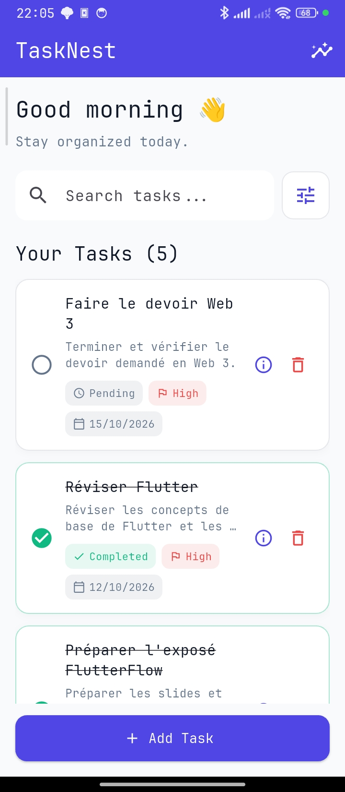
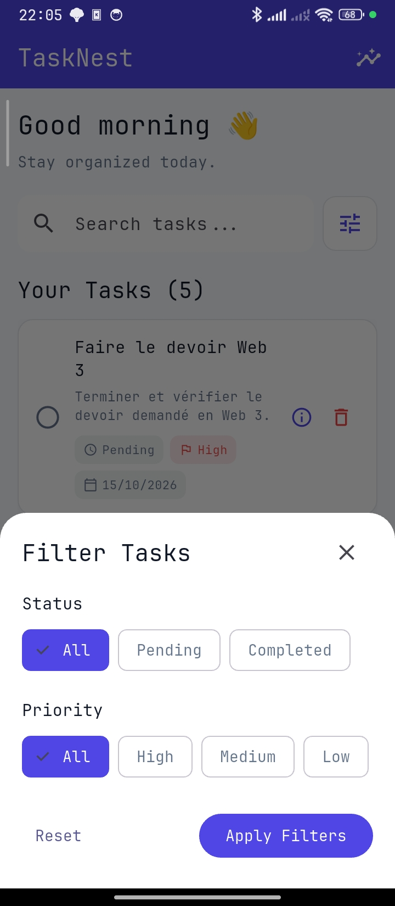
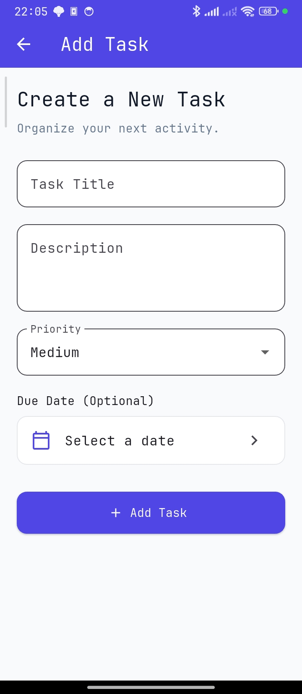
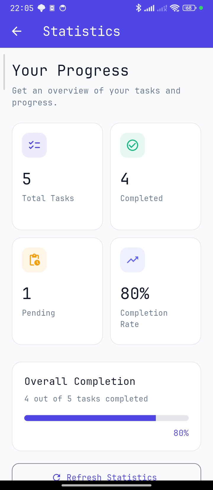

# TaskNest

> A clean, focused task-management app for Android & the web — create, search, filter, complete, and track your daily tasks with a live statistics dashboard.

TaskNest is a **Flutter** task-management application powered by **Supabase / PostgreSQL**, verified on **Android and Web**. It lets you organize your day with a small, fast, and readable UI: create tasks with priorities and due dates, search and filter them in real time, mark them complete with a single tap, and review your progress on a dedicated statistics screen.

Built originally as a FlutterFlow school demo, TaskNest was recreated by hand as a **standard Flutter application** — separating UI, the data model, and database access into clear layers instead of relying on generated code.


[](https://github.com/zidi-abderrahmen/task-nest/actions/workflows/flutter.yml)

<p align="center">
  <a href="https://youtu.be/v_In0BOq7Dk?si=TC1Ewqr1UXUYOthZ">🔗 YT Shorts Android App Demo</a>
  |
  <a href="https://youtu.be/wIUE7hF-_F4">🔗 YT Video Web Demo</a>
</p>

<div align="center">

| | |
|:---:|:---:|
| *Home Page* | *Filter Menu* |
|  |  |
| *Add / Edit Task* | *Statistics* |
|  |  |

</div>

---

## Table of Contents

- [Overview](#overview)
- [Quick Start](#quick-start)
- [Features](#features)
- [Architecture](#architecture)
- [Project Structure](#project-structure)
- [Routing & Navigation](#routing--navigation)
- [Database & Data Layer](#database--data-layer)
- [Priority & Sorting](#priority--sorting)
- [CRUD Summary](#crud-summary)
- [Installation](#installation)
- [Environment Setup](#environment-setup)
- [Running Locally](#running-locally)
- [Build & Release](#build--release)
- [Android & Web (Platform & Networking)](#android--web-platform--networking)
- [Testing & Quality](#testing--quality)
- [Performance & Security Considerations](#performance--security-considerations)
- [Known Limitations](#known-limitations)
- [Project History](#project-history)
- [Roadmap](#roadmap)
- [Contributing](#contributing)
- [License](#license)
- [Author](#author)

---

## Overview

TaskNest is the client-only half of a Supabase-backed task manager. There is no custom backend to deploy: the app talks directly to a Supabase project whose `public.tasks` table is the single source of truth.

**What it delivers**

- A **single home screen that does the real work** — tasks are fetched from Supabase and displayed as cards with status, priority, and due-date badges.
- **Real-time-feeling filtering without extra complexity** — search, status, and priority filters are combined client-side on the already-fetched list, so results update instantly as you type.
- A **complete task lifecycle** — create, view, edit, toggle completion, and delete (with confirmation) tasks end to end.
- **At-a-glance progress** — a statistics page computes total, completed, pending, completion rate, and an overall progress bar from the same task data.
- **A manually re-architected base** — instead of keeping everything in one generated file, the project separates the `Task` model, a `TaskService` data-access layer, and five focused UI pages.

**Business value**

Small and deliberate. The entire feature set lives in five readable pages and one data service, which makes the codebase easy to extend — authentication, per-user tasks, and tests are all natural next steps (see the [Roadmap](#roadmap)).

---

## Features

### Task management

| Area | Description |
| --- | --- |
| **Home list** | Fetches tasks from Supabase on startup and refreshes after any mutation. |
| **Task counter** | `Your Tasks (n)` reflects the number of tasks in the **currently filtered** list. |
| **Search** | Case-insensitive search by task title; a clear button appears when text is entered. |
| **Status filter** | `All`, `Pending`, and `Completed`, chosen in a bottom-sheet filter panel. |
| **Priority filter** | `All`, `High`, `Medium`, and `Low`, combined with status and search. |
| **Filter panel** | A filter button beside the search field opens a bottom sheet with visual selection, `Reset`, and `Apply Filters`. |
| **Task cards** | Title, optional description, completion state, priority badge, due-date badge, and overdue warnings. |
| **Complete / un-complete** | Tapping a card toggles the task between completed and pending. |
| **Details** | An information button opens the full task details page. |
| **Delete** | A delete button opens a confirmation dialog before removing the task. |

### Add & edit

| Area | Description |
| --- | --- |
| **Add Task** | Form with required title, optional description, priority dropdown, and optional due date. |
| **Validation** | Empty titles are rejected; the form blocks saving until valid. |
| **Edit Task** | Pre-populated form that updates the existing row by its database ID — no duplicates are created. |
| **Completion preserved** | Editing details never changes the completion state. |
| **Saving state** | Disabled fields, a spinner, and a `Saving...` label while the request is in flight. |

### Statistics

| Area | Description |
| --- | --- |
| **Total Tasks** | Number of fetched tasks. |
| **Completed** | Tasks where `completed == true`. |
| **Pending** | `Total - Completed`. |
| **Completion Rate** | `Completed / Total × 100`, safely `0` when there are no tasks. |
| **Overall progress** | A `LinearProgressIndicator` plus a `Refresh Statistics` / retry control. |

### Platform & reliability

- Loading spinners for every async screen and a **Retry** action on load failure.
- SnackBar error messages for create, update, and delete failures.
- The full fetch → show → mutate → **re-fetch** cycle; no Supabase Realtime subscriptions are used.

> **Client-side filtering** — search, status, and priority filters are applied in memory over the fetched list (`home_page.dart`), not as server-side query filters. Refresh is done by re-fetching tasks after an operation; the application does **not** subscribe to Supabase Realtime.

---

## Quick Start

```bash
# 1. Clone the repository
git clone https://github.com/zidi-abderrahmen/task-nest.git
cd task-nest

# 2. Resolve dependencies
flutter pub get

# 3. Create your local environment file from the committed template
cp env.example.json env.json

# 4. Run on a device, emulator, or Chrome
flutter run --dart-define-from-file=env.json
```

Before running, open `env.json` and set your own Supabase project values (see [Environment Setup](#environment-setup)).

---

## Tech Stack

| Layer | Technology |
| --- | --- |
| **Framework** | [Flutter](https://flutter.dev/) `≥ 3.44` (Material 3, `ColorScheme.fromSeed`) |
| **Language** | [Dart](https://dart.dev/) `≥ 3.13.5` (project SDK constraint `^3.13.5`) |
| **Backend** | [Supabase](https://supabase.com/) — hosted Postgres, REST API, and auth-ready infrastructure |
| **Database** | PostgreSQL (managed by Supabase) — `public.tasks` table |
| **Client SDK** | [`supabase_flutter`](https://pub.dev/packages/supabase_flutter) `^2.18.2` |
| **Icons** | `cupertino_icons` `^1.0.8` |
| **Linting** | `flutter_lints` `^6.0.0` (dev dependency, via `analysis_options.yaml`) |
| **Testing** | `flutter_test` + `http` (dev dependency, fake HTTP client for service tests) |
| **CI** | GitHub Actions — `flutter analyze` + `flutter test` via [`subosito/flutter-action`](https://github.com/subosito/flutter-action) |
| **Platform** | Android (`applicationId`: `com.example.tasknest_flutter`) and Web — both verified |
| **State management** | None external — Flutter `StatefulWidget` + `setState` |
| **Data access** | `TaskService` over the Supabase client (`TaskService.fetchTasks`, `addTask`, `updateTask`, `updateTaskCompletion`, `deleteTask`) |

Values were verified from `pubspec.yaml`, `pubspec.lock`, and the Flutter Android manifest. No provider/Riverpod/BLoC package, no Google Fonts, and no additional assets or fonts are declared.

---

## Architecture

The project follows a simple and deliberate separation of concerns — no state-management library, no over-engineered layers:

- **`Task` model** — an immutable Dart class with a `fromMap` factory that converts a Supabase row into a `Task`.
- **`TaskService`** — the single owner of database access; every query/insert/update/delete goes through it.
- **Pages** — each screen owns its own widget structure and local state (`setState`), calling `TaskService` when data changes.
- **`main.dart`** — initializes Supabase and defines the Material 3 theme (seed color `0xFF4F46E5`).

**Key design decisions**

- **No Shimmer/Redux/BLoC ceremony.** Screen state is plain `StatefulWidget` state; the app is small enough that `setState` keeps it readable.
- **Reusable pieces as private methods.** The task badge and task card are implemented inside the pages that use them — there is no `lib/widgets/` directory.
- **Refresh-by-re-fetch.** Pages return a result (`true` from Add, an updated `Task` from Edit) and Home re-fetches when the route pops, keeping the list consistent without Realtime.

### Application flow

When the app boots, `main()` reads the Supabase configuration from compile-time environment variables, initializes the client, and shows `HomePage`. Home fetches all tasks once, then applies search/status/priority filtering locally; mutations trigger a fresh fetch.

### Data flow

```text
┌────────────────────────────────────────────┐
│              Flutter UI (pages)            │
│   Home · Add · Edit · Details · Statistics │
└────────────────────┬───────────────────────┘
                     │ model + service calls
                     ▼
┌────────────────────────────────────────────┐
│         Task model  +  TaskService         │
└────────────────────┬───────────────────────┘
                     │ supabase_flutter
                     ▼
┌────────────────────────────────────────────┐
│           Supabase Flutter client          │
└────────────────────┬───────────────────────┘
                     │ REST (JSON)
                     ▼
┌────────────────────────────────────────────┐
│              Supabase REST API             │
└────────────────────┬───────────────────────┘
                     ▼
┌────────────────────────────────────────────┐
│        PostgreSQL · public.tasks table     │
└────────────────────────────────────────────┘
```

**UI vs. service responsibilities** — the UI owns form state, validation, filtering, dialogs, SnackBars, and navigation; `TaskService` owns the exact Supabase queries and how rows map to objects. Pages never talk to the database directly.

---

## Project Structure

```
tasknest_flutter/
├── android/                          # Android platform project (manifest, Gradle, launcher icons)
├── lib/
│   ├── main.dart                     # Entry point: Supabase init + Material 3 app shell
│   ├── models/
│   │   ├── task.dart                 # Task model + Task.fromMap (Supabase row → Task)
│   │   └── task_statistics.dart      # TaskStatistics.fromTasks (progress metrics)
│   ├── services/
│   │   └── task_service.dart         # All Supabase CRUD operations
│   ├── utils/
│   │   └── task_filters.dart         # Shared search/status/priority filtering logic
│   └── pages/
│       ├── home_page.dart            # Task list, search, filters, delete, navigation
│       ├── add_task_page.dart        # Create-task form
│       ├── edit_task_page.dart       # Edit-task form (pre-populated)
│       ├── task_details_page.dart    # Read-only task view + Edit entry point
│       └── statistics_page.dart      # Progress metrics + completion bar
├── test/
│   ├── task_model_test.dart          # Task.fromMap parsing + due-date handling
│   ├── task_filters_test.dart        # Priority order + combined filtering
│   ├── task_statistics_test.dart     # Completion metrics (incl. empty list)
│   ├── task_service_test.dart        # CRUD against a fake HTTP client + errors
│   └── add_task_page_test.dart       # Add Task form validation (empty/blank title)
├── .github/
│   └── workflows/
│       └── flutter.yml               # GitHub Actions CI: analyze + test
├── env.example.json                  # Committed env template (placeholders only)
├── env.json                          # Local Supabase config (git-ignored)
├── .gitignore                        # Ignores env.json and flutterflow_reference/
└── pubspec.yaml
```

> The `android/`, `ios/`, `linux/`, `macos/`, `web/`, and `windows/` folders come from the standard Flutter project template. The **Android** and **Web** targets are the verified platforms for this application.

---

## Routing & Navigation

Navigation uses Flutter's built-in `Navigator` with `MaterialPageRoute` — there is no named-route table and no routing package.

| Flow | Path | Notes |
| --- | --- | --- |
| Add a task | `HomePage → AddTaskPage` | Returns `true` on success; Home re-fetches. |
| View a task | `HomePage → TaskDetailsPage` | Opened via the info button on a task card. |
| Edit a task | `TaskDetailsPage → EditTaskPage` | Returns the updated `Task`; Details re-renders and Home re-fetches on return. |
| View statistics | `HomePage → StatisticsPage` | Opened via the app-bar insights button. |

There is intentionally **no edit button on Home's task cards** — editing is reached from the Task Details page to keep the cards clean.

---

## Database & Data Layer

The application uses the existing Supabase project and its `public.tasks` table. This schema already exists in Supabase — it should **not** be recreated blindly:

```sql
create table public.tasks (
  id uuid not null default gen_random_uuid(),
  title text null default ''::text,
  description text null default ''::text,
  completed boolean null,
  created_at timestamp with time zone not null default now(),
  priority text null,
  due_date date null,
  priority_order integer null,
  constraint tasks_pkey primary key (id)
);
```

| Column | Purpose | Mapped in `Task` |
| --- | --- | --- |
| `id` | Unique task identifier, generated as a UUID by the database | `id` |
| `title` | Task title | `title` |
| `description` | Optional task description | `description` |
| `completed` | Completion state (`true` / `false`) | `completed` |
| `created_at` | Creation timestamp, defaulted by the database | `createdAt` |
| `priority` | Task priority (`High` / `Medium` / `Low`) | `priority` |
| `due_date` | Optional due date (date only) | `dueDate` |
| `priority_order` | Numeric value used for priority sorting | `priorityOrder` |

The app writes `id` and `created_at` never — they are database defaults. It also never sends a `completed` value on edit, so changing details never resets completion.

---

## Priority & Sorting

Priorities map to a numeric `priority_order` when a task is created or edited:

| Priority | `priority_order` |
|---|:---:|
| High | 3 |
| Medium | 2 |
| Low | 1 |

**Current behavior in `task_service.dart`** — `fetchTasks` requests ordering by `priority_order` and then by `created_at`:

```dart
_client
    .from('tasks')
    .select()
    .order('priority_order')
    .order('created_at');
```

Both `order` calls use Supabase's default ascending direction (no `ascending: false` is passed). The actual result is therefore **ascending** `priority_order` (Low → Medium → High) and, within equal values, **oldest-first** `created_at`. This should be kept in mind before assuming high-priority tasks appear first.

---

## CRUD Summary

| Operation | Implementation |
| --- | --- |
| **Create** | `TaskService.addTask` — inserts a new row (title, description, priority, `priority_order`, optional due date, `completed: false`). |
| **Read** | `TaskService.fetchTasks` — selects all rows from `tasks` and maps each to a `Task`. |
| **Update** | `TaskService.updateTask` — edits title, description, priority, `priority_order`, and due date by `id`, preserving completion; `TaskService.updateTaskCompletion` toggles the `completed` flag. |
| **Delete** | `TaskService.deleteTask` — removes a row by `id` after user confirmation in the UI. |

---

## Installation

**Prerequisites**

- Flutter SDK `≥ 3.44` (Dart `≥ 3.13.5` ships with Flutter).
- Android SDK with a device or emulator set up (`flutter doctor` should report a functional Android toolchain).
- A Supabase project containing the `tasks` table described in [Database & Data Layer](#database--data-layer).

```bash
# 1. Clone the repository
git clone https://github.com/zidi-abderrahmen/task-nest.git
cd task-nest

# 2. Resolve dependencies
flutter pub get
```

---

## Environment Setup

TaskNest reads its Supabase configuration at compile time using Dart `const` environment variables:

```dart
const supabaseUrl = String.fromEnvironment('SUPABASE_URL');
const supabasePublishableKey =
    String.fromEnvironment('SUPABASE_PUBLISHABLE_KEY');
```

Values are supplied through a local `env.json` file that is **git-ignored** (`.gitignore` contains `/env.json`). A committed template is available at **`env.example.json`** (placeholders only — no secrets). Create your local file and replace the placeholders with values from **your own** Supabase project (Project Settings → API):

```bash
cp env.example.json env.json
```

```json
{
  "SUPABASE_URL": "https://your-project.supabase.co",
  "SUPABASE_PUBLISHABLE_KEY": "your-publishable-anon-key"
}
```

> `env.example.json` stays committed so collaborators can see the expected shape at a glance, while the real `env.json` with your credentials stays local and out of Git.

**Configuration notes**

- Keeping `env.json` out of Git prevents accidental commits of local configuration.
- `--dart-define-from-file` does **not** make values secret once embedded in a compiled APK — anyone who extracts the APK can inspect them.
- The Supabase **publishable** key is intended for client apps. The **`service_role`** key must never be embedded in a Flutter application.
- If the app is started without configuration, `main()` throws a `StateError` telling you to run with `--dart-define-from-file=env.json`.

---

## Running Locally

Run on your default device (emulator, connected Android device, or Chrome):

```bash
flutter run --dart-define-from-file=env.json
```

Or target a specific device, for example Chrome for the web version:

```bash
flutter run -d chrome --dart-define-from-file=env.json
```

The flag is mandatory: without it `SUPABASE_URL` and `SUPABASE_PUBLISHABLE_KEY` are empty and Supabase cannot initialize. IDE run configurations (Android Studio / VS Code) must include the same `--dart-define-from-file=env.json` argument.

---

## Build & Release

Build a release APK with your local environment file:

```bash
flutter build apk --release --dart-define-from-file=env.json
```

The artifact is written to:

```text
build/app/outputs/flutter-apk/app-release.apk
```

Install it on a connected Android device (with USB debugging enabled) using:

```bash
adb install build/app/outputs/flutter-apk/app-release.apk
```

### Web build

Build the web version with your local environment file:

```bash
flutter build web --dart-define-from-file=env.json
```

The compiled web app is written to `build/web/` and can be served by any static web server.

---

## Android & Web (Platform & Networking)

**Android** — the main manifest (`android/app/src/main/AndroidManifest.xml`) declares Internet access:

```xml
<uses-permission android:name="android.permission.INTERNET" />
```

This is required so the app can reach the Supabase REST API on Android. The debug and profile manifests declare the same permission for development (hot reload / debugger communication). The application ID is `com.example.tasknest_flutter`.

**Web** — the app runs in the browser through Flutter web and talks to the same Supabase project using the same compile-time environment variables. All screens, filtering, and statistics were verified in a browser. No extra permission is needed on the web besides browser access to the Supabase endpoint.

---

## Testing & Quality

TaskNest ships a **real test suite** (replacing the default Flutter template test) plus a **GitHub Actions CI pipeline** that runs on every push and pull request to `main`.

| Test file | Covers |
| --- | --- |
| `test/task_model_test.dart` | `Task.fromMap` row parsing, defaults, due-date parsing, and `priority_order` handling. |
| `test/task_filters_test.dart` | `Task.priorityOrderFor` mapping and `filterTasks` — search, status, priority, combined, and empty-list behavior. |
| `test/task_statistics_test.dart` | `TaskStatistics.fromTasks` — totals, completion rate, rounded percentage, including the empty-list case. |
| `test/task_service_test.dart` | `TaskService` CRUD against a **fake HTTP client** — request payloads, ordering, and `PostgrestException` propagation on server errors. |
| `test/add_task_page_test.dart` | Add Task form rejects empty and blank titles. |

Run the quality gates locally:

```bash
flutter analyze   # static analysis (flutter_lints)
flutter test      # runs the full suite above
```

CI (`.github/workflows/flutter.yml`) installs the latest **stable** Flutter channel and runs `flutter pub get`, `flutter analyze`, and `flutter test`. Its status badge sits in the header of this README.

---

## Performance & Security Considerations

### Performance

- The feature set is small and dependency-light (one first-party data package).
- Filtering is in-memory, so search and filter changes are instant on already-loaded data.
- Lists use `ListView.builder`-style lazy building for task cards.

### Security

- **No authentication and no user accounts.** The app performs unauthenticated CRUD against the `tasks` table.
- **Demo RLS setup (described by the developer, not verifiable from the source).** The original TaskNest school-demo Supabase configuration allows anonymous `SELECT`, `INSERT`, `UPDATE`, and `DELETE` on `tasks`. These policies live in the remote Supabase dashboard; the Flutter source can only confirm that the app sends no auth token. Use access to the dashboard (SQL editor → RLS policies) to verify them.
- Unrestricted anonymous access is fine on a **demo with non-sensitive data** only. It is not an appropriate configuration for protecting private or sensitive task data.
- The publishable key is client-safe; the `service_role` key must never be shipped in the app.

Client-side guards would be a UX layer anyway — in any future multi-user setup, Supabase RLS policies remain the source of truth.

---

## Known Limitations

- No authentication, user ownership, or per-user data isolation.
- No Supabase Realtime: changes made by another client are not pushed; the list refreshes only on navigation/mutation.
- Filters and search run client-side over the full fetched list (fine at demo scale).
- Sorting relies on Supabase default ascending order for `priority_order` and `created_at`.
- Colors and styling constants are repeated across pages rather than centralized in a theme file.
- The web build is verified in a browser but ships without PWA/service-worker offline support.

---

## Project History

TaskNest started as a **FlutterFlow** project built visually for a school assignment, connected to Supabase and covering task creation, listing, editing, deletion, completion toggling, search, and task details.

Since FlutterFlow's full code export required a premium subscription, the generated **Widget and Model code was inspected via the View Code tab** and used as a reference. The application was then recreated as a **standard Flutter project**:

- FlutterFlow-specific helpers and dependencies were replaced with native Flutter widgets, navigation, forms, dialogs, and state handling.
- A Dart `Task` model (`Task.fromMap`) was created for database-row conversion.
- All Supabase operations were isolated into a `TaskService`.
- Combined search + status + priority filtering was added on top of the fetched list.
- Task cards gained status/priority badges, priority colors, completion styling, and overdue warnings.
- A Statistics page with calculated metrics and a progress bar was added.
- Form validation, delete confirmation, loading states, and error handling were introduced.
- The default template test was replaced with a real suite covering the model, filters, statistics, the service, and form validation, and a GitHub Actions CI pipeline was added.

The result is a **manually adapted implementation** — not a full FlutterFlow export — with a clearer separation between UI, the data model, and database access.

---

## Roadmap

Implemented today:

- [x] Task CRUD against Supabase.
- [x] Search + status + priority filtering (client-side).
- [x] Task details and edit flows.
- [x] Statistics with completion rate and progress bar.
- [x] Delete confirmation, validation, loading, and error states.
- [x] Automated unit, widget, and service tests plus a GitHub Actions CI pipeline.

Planned next steps:

- [ ] Authentication and per-user task ownership.
- [ ] User-specific Row Level Security policies.
- [ ] Coverage reporting and more edge-case widget tests.
- [ ] Accessibility and localization improvements.
- [ ] Offline task access via a local persistence strategy.
- [ ] Optional Supabase Realtime updates for live multi-client sync.

---

## Contributing

Contributions are welcome. To keep the codebase consistent:

1. Fork the repository and create a feature branch (`git checkout -b feat/your-feature`).
2. Follow the existing conventions — native Flutter widgets, logic in pages, all database access through `TaskService`, no new dependencies without a reason.
3. Run the quality gates locally before pushing:

```bash
dart format lib test
flutter analyze
flutter test
```

4. Open a pull request describing the change, the motivation, and how it was tested.

Commit messages follow a simple conventional style, e.g. `feat: added …`, `fix: corrected …`, `refactor: …`.

---

## License

TaskNest is distributed under the **MIT License**.
See the [LICENSE](./LICENSE) file for the complete license text.

Copyright (c) 2026 **Zidi Abderrahmen**

---

## Author

**Zidi Abderrahmen** — Computer science student and developer.

- 🎓 Built TaskNest as a cross-platform frameworks assignment, evolving it from a visual FlutterFlow prototype into a hand-built Flutter app.
- 📩 Contact: `zd.abderrahmen@gmail.com`

---

*If you find this project useful, consider starring the repository. It helps a student developer keep building.*
